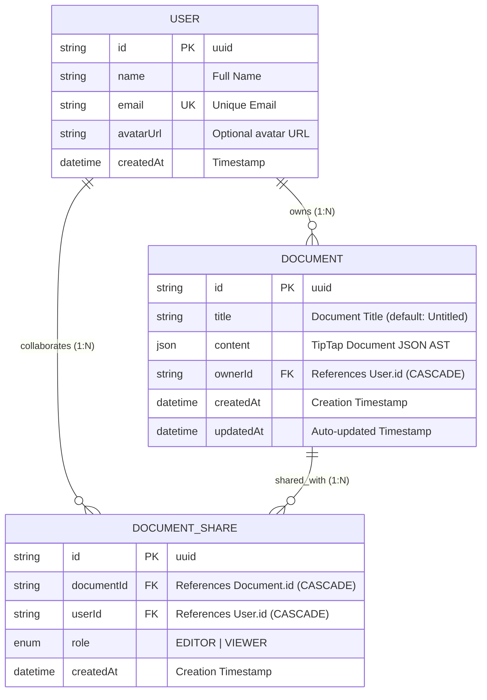
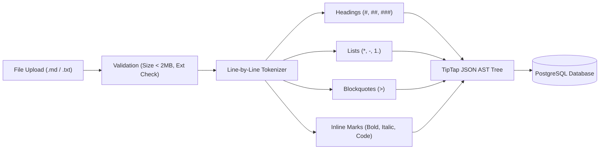
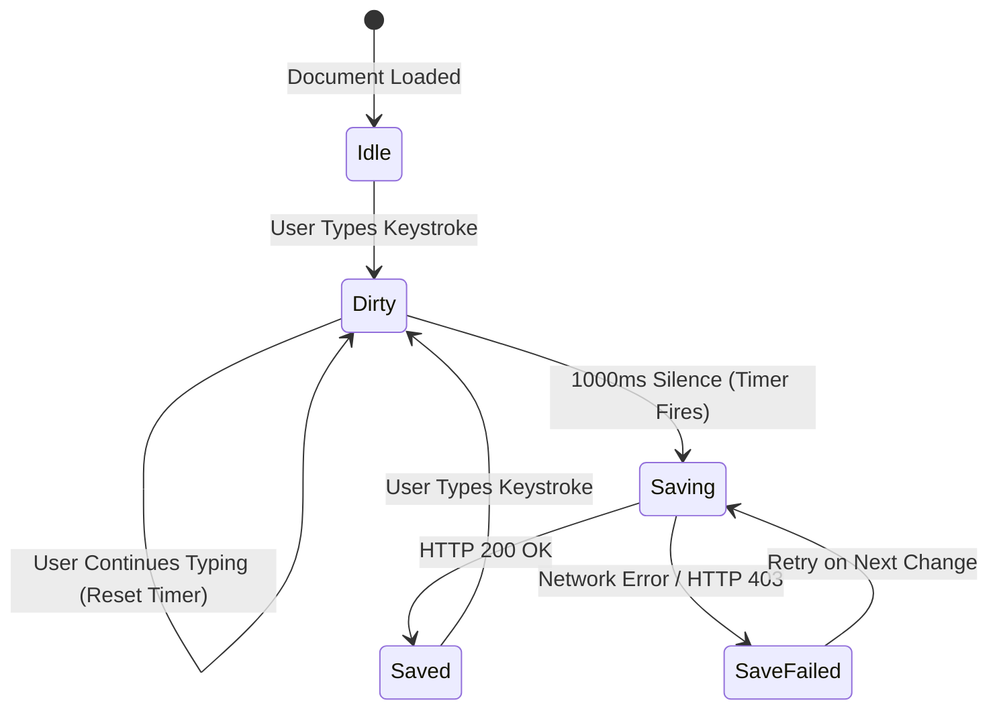

# PaperSpace — System Architecture & Design Specification

> **Document Version:** 1.0.0  
> **Author:** Hemant Singh  
> **Assessment:** Ajaia AI-Native Full Stack Developer Assessment  
> **Target Platform:** Next.js 15 (App Router), Prisma 6, PostgreSQL, TipTap 2.x, Vercel

---

## 1. System Overview

**PaperSpace** is designed as a modular, monolithic full-stack application built on Next.js 15. The system unifies a modern React frontend (client-side interactive editor) with server-side API Route Handlers running on Vercel's edge/node runtime, backed by PostgreSQL accessed through Prisma 6.

```mermaid
flowchart TD
    subgraph Client ["Client Browser (React 19 / Next.js)"]
        UI_Nav["Navbar & Demo Switcher"]
        UI_Dash["Dashboard (Owned & Shared Docs)"]
        UI_Editor["TipTap Rich-Text Editor Canvas"]
        UI_Toolbar["Formatting Toolbar"]
        UI_Modals["Share Dialog & Import Modal"]
    end

    subgraph Server ["Next.js Server (Route Handlers)"]
        AuthMiddleware["Auth Helper (Cookie Resolver)"]
        RBAC["RBAC Engine (evaluateDocumentPermissions)"]
        ZodVal["Zod Validation Layer"]
        ImportParser["Markdown / TXT AST Importer"]
    end

    subgraph Database ["Persistence Layer (PostgreSQL 16 / Supabase)"]
        Prisma["Prisma ORM 6"]
        T_Users["Table: users"]
        T_Docs["Table: documents (TipTap JSON)"]
        T_Shares["Table: document_shares"]
    end

    UI_Nav -->|POST /api/auth/switch| AuthMiddleware
    UI_Dash -->|GET /api/documents| Server
    UI_Editor -->|PATCH /api/documents/:id (Autosave)| Server
    UI_Toolbar -.->|Commands| UI_Editor
    UI_Modals -->|POST /api/documents/:id/shares| Server
    UI_Modals -->|POST /api/import| ImportParser

    Server --> AuthMiddleware --> RBAC --> ZodVal --> Prisma
    Prisma --> T_Users
    Prisma --> T_Docs
    Prisma --> T_Shares
```

---

## 2. Relational Data Model

The schema is defined in Prisma (`prisma/schema.prisma`) targeting PostgreSQL. It features clean foreign-key cascades, compound unique constraints, and optimized indexes on foreign keys.



### Indexing & Integrity Strategy
1. **`Document.ownerId` Index**: Accelerates dashboard queries fetching documents owned by the active user.
2. **`DocumentShare.documentId` Index**: Optimizes collaborator lookups when loading an individual document.
3. **`DocumentShare.userId` Index**: Accelerates dashboard queries fetching documents shared with the active user.
4. **`Unique(documentId, userId)` Constraint**: Prevents duplicate share relationships; a user can only have one explicit role per document.
5. **Cascading Deletes (`onDelete: Cascade`)**: When an owner deletes a document, all associated shares in `document_shares` are automatically pruned by PostgreSQL.

---

## 3. Security & Role-Based Access Control (RBAC)

### A. Authorization Matrix

Authorization is enforced server-side on every request in `src/lib/permissions.ts`.

| Operation | OWNER | EDITOR | VIEWER | UNAUTHORIZED / NONE |
|---|:---:|:---:|:---:|:---:|
| **Read Document (`GET /api/documents/:id`)** | ✅ Allow | ✅ Allow | ✅ Allow | ❌ **404 Not Found** |
| **Edit Content (`PATCH /api/documents/:id`)** | ✅ Allow | ✅ Allow | 🚫 **403 Forbidden** | ❌ **404 Not Found** |
| **Rename Title (`PATCH /api/documents/:id`)** | ✅ Allow | 🚫 **403 Forbidden** | 🚫 **403 Forbidden** | ❌ **404 Not Found** |
| **Delete Document (`DELETE /api/documents/:id`)** | ✅ Allow | 🚫 **403 Forbidden** | 🚫 **403 Forbidden** | ❌ **404 Not Found** |
| **Manage Shares (`POST/PATCH/DELETE /shares`)** | ✅ Allow | 🚫 **403 Forbidden** | 🚫 **403 Forbidden** | ❌ **404 Not Found** |

### B. Information Hiding (404 vs. 403 Principle)
- **HTTP 404 for Unauthorized Users**: If a user attempts to access a document they do not own and that has not been shared with them, the API returns `404 Not Found` rather than `403 Forbidden`. This security measure prevents malicious actors from enumerating valid document UUIDs.
- **HTTP 403 for Insufficient Role**: If a user has legitimate read access (e.g. Editor attempting to rename a title, or Viewer attempting to save content), the API returns `403 Forbidden` with a descriptive error message explaining why the action was rejected.

### C. Row Level Security (RLS) Decision
Supabase provides PostgreSQL Row Level Security (RLS). In PaperSpace, database authorization is intentionally centralized in the **Next.js Server Layer** rather than database RLS policies.
- *Reasoning*: Next.js connects to PostgreSQL via Prisma using a pooled backend service role. Enforcing RBAC in application code ensures unified Zod validation, granular audit logging, informative client error responses, and complete database portability (the application can run on Supabase, AWS RDS, Neon, or vanilla PostgreSQL without vendor lock-in).
- *Supabase Security*: The Supabase public REST API (PostgREST) is not exposed to the browser; direct database connections are restricted to server-side code only.

---

## 4. TipTap Rich-Text Engine & AST Storage

### A. Storage Format: TipTap JSON AST
Rather than storing raw HTML (`<p>Hello <b>World</b></p>`), PaperSpace stores documents as structured Abstract Syntax Trees (AST):

```json
{
  "type": "doc",
  "content": [
    {
      "type": "heading",
      "attrs": { "level": 1 },
      "content": [{ "type": "text", "text": "PaperSpace Engineering" }]
    },
    {
      "type": "paragraph",
      "content": [
        { "type": "text", "text": "This text is " },
        { "type": "text", "marks": [{ "type": "bold" }], "text": "strongly typed" }
      ]
    }
  ]
}
```

### Benefits:
1. **XSS Immunity**: JSON AST nodes cannot execute embedded `<script>` tags or malicious HTML attributes.
2. **Deterministic Traversal**: Enables server-side text extraction, search indexing, and future conversion to PDF or DOCX without DOM dependencies.
3. **Granular Collaboration**: Sets the foundation for CRDT operational transforms (Yjs).

---

## 5. File Import Engine Architecture

The file ingestion engine (`src/lib/importer.ts`) transforms uploaded `.txt` and `.md` files into valid TipTap AST documents entirely in memory.



### Parser Rules:
- `# Title` -> `heading` node with `attrs: { level: 1 }`
- `## Subtitle` -> `heading` node with `attrs: { level: 2 }`
- `### Section` -> `heading` node with `attrs: { level: 3 }`
- `> Quote` -> `blockquote` container node
- `* Bullet` or `- Bullet` -> `bulletList` with `listItem` children
- `1. Number` -> `orderedList` with `listItem` children
- `**bold**`, `*italic*`, `` `code` `` -> `text` nodes with mark arrays
- Title derivation: `system-architecture-v2.md` -> `"System Architecture V2"`

---

## 6. Debounced Autosave Architecture

To deliver a responsive user experience without overwhelming the server or database with keystroke-by-keystroke writes, the editor employs a debounced state machine:



### Key Technical Details:
- **Debounce Window**: 1000ms.
- **Payload Minimization**: Only the updated `content` JSON AST is transmitted over the wire.
- **Visual Feedback**: Real-time status badge indicates `Saving...` (Indigo pulse), `Saved` (Emerald check), and `Save failed` (Rose alert).

---

## 7. Database Connection & Pooling Strategy

When deployed to Vercel (serverless functions), traditional direct PostgreSQL connections can quickly exhaust connection limits. PaperSpace uses Prisma 6's dual-connection pattern:

1. **`DATABASE_URL` (Transaction Pooler - Port 6543)**:
   - Configured with PgBouncer transaction mode (`?pgbouncer=true`).
   - Reuses connections across ephemeral serverless invocations.
   - Used for all runtime queries (`findMany`, `create`, `update`).
2. **`DIRECT_URL` (Direct Connection - Port 5432)**:
   - Connects directly to the PostgreSQL instance without PgBouncer session restrictions.
   - Reserved exclusively for schema migrations (`prisma db push`, `prisma migrate`).
